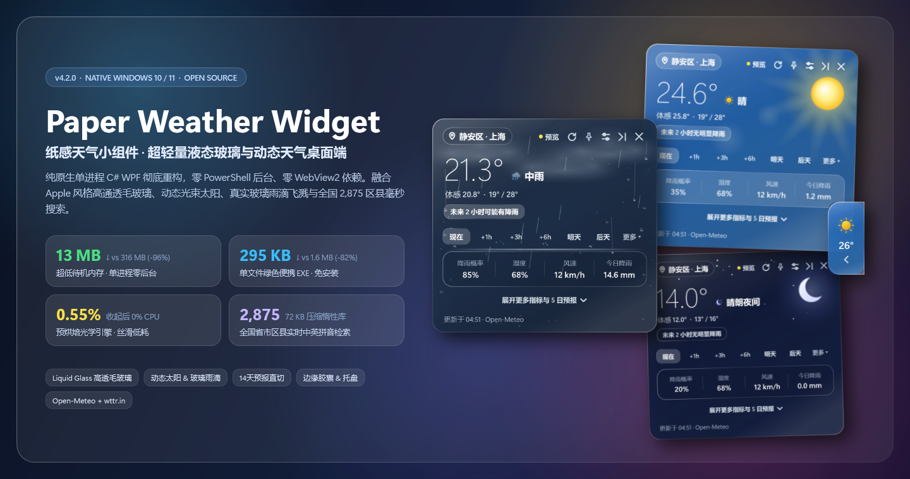
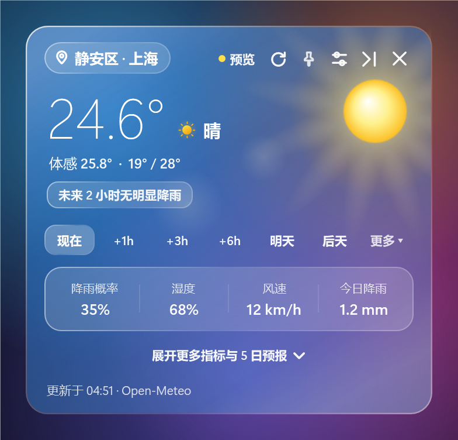
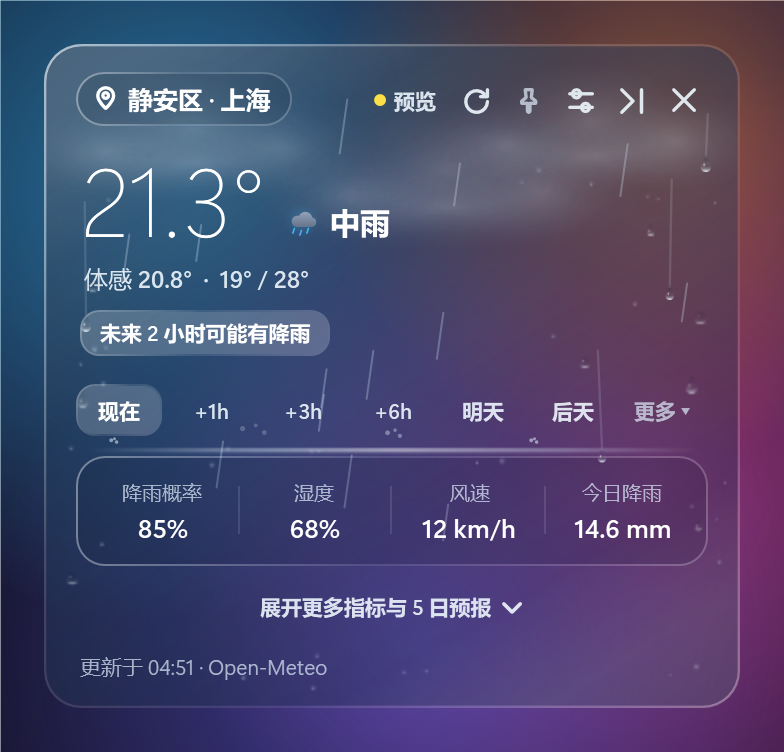
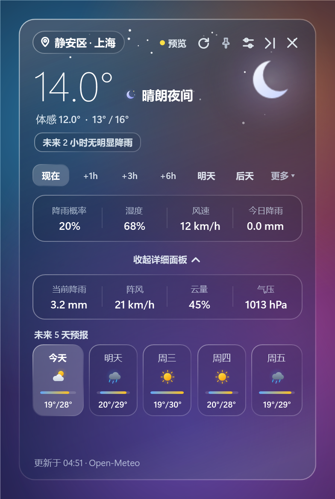
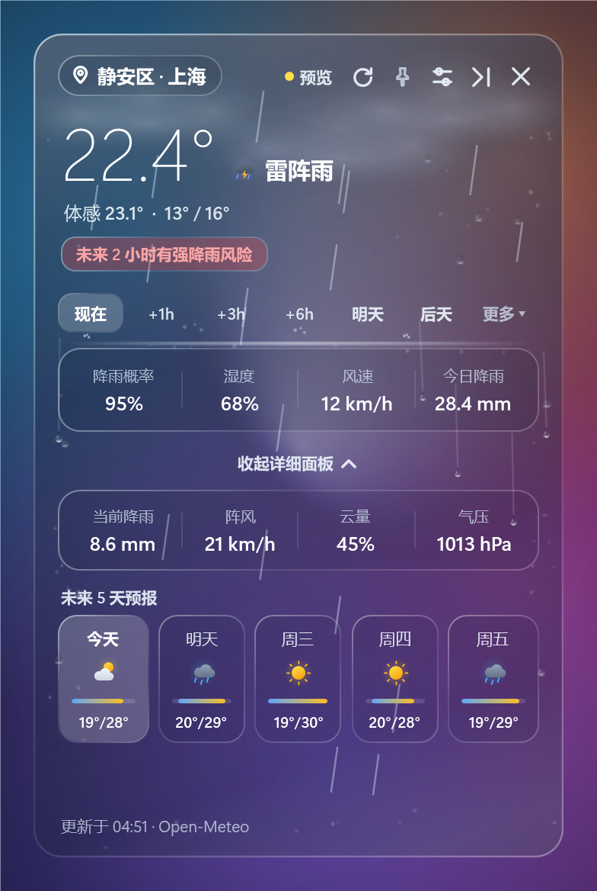
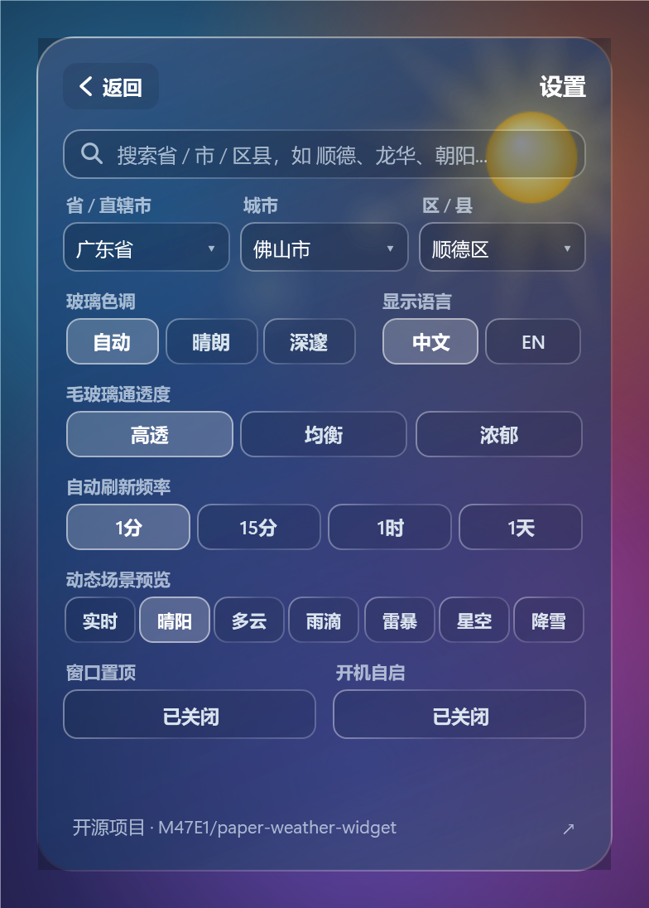
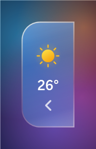

<p align="center">
  
</p>

<h1 align="center">Paper Weather Widget v4.2.0 / 纸感天气小组件</h1>

<p align="center">
  <strong>超轻量原生 Windows 10/11 液态玻璃动态天气桌面小组件</strong><br />
  Lightweight single-process native C# WPF desktop weather widget with native Windows 11 rounded Acrylic Liquid Glass, real-time animated skies & frosted-glass raindrops, 5-day temperature range bars, and ~13 MB idle RAM.
</p>

<p align="center">
  <a href="https://github.com/M47E1/paper-weather-widget/releases/latest"></a>
  
  
  
</p>

---

## Why v4.2.0 Replaces the Legacy Widget / 为什么彻底重构替代旧版？

旧版 v1–v3 依赖双进程架构（WPF 启动器 + 常驻 `powershell.exe` 后台脚本 + 每次启动释放 1.34 MB 未压缩 JSON + 文件轮询 IPC），仅展示静态天气卡片就占用超过 **316 MB 内存**，且设置面板高达 790px 容易撑出屏幕。

**v4.2.0 已彻底重写为单一纯原生 C# WPF 可执行文件（零 PowerShell、零 WebView2 / Electron、零安装、零临时脚本释放）**，在内存骤降 96% 的同时带来 Windows 11 原生抗锯齿圆角 Acrylic 液态毛玻璃与 Apple Weather 级别的动态天气观感：

| Metric / 指标 | Legacy v3.0.0（旧版静态） | **v4.2.0（原生 Win11 液态玻璃 + 动态天气）** | Improvement / 提升 |
| --- | --- | --- | --- |
| Background Processes / 进程数 | 2（WPF + `powershell.exe`） | **1**（纯原生单进程） | 彻底消灭后台脚本进程 |
| Idle Working Set / 待机物理内存 | 316.28 MB | **~13.3 MB** | **下降 95.8%** |
| Private RAM / 专用提交内存 | 266.39 MB | **~71.9 MB**（`SoftwareOnly`） | **下降 73.0%** |
| Animated Avg CPU / 动画实时 CPU | —（静态） | **0.55% 晴 / 1.9% 雨 / 0% 收起** | 原生 Win11 合成 + 预烘焙分层渲染 |
| Single EXE Size / 单文件体积 | 1,625.6 KB | **295.0 KB** | **缩小 81.9%** |
| Region Catalog (2,875 Districts) | 1,342.6 KB JSON | **72.7 KB GZip TSV**（用完即释放） | **缩小 94.6%** |

---

## Core Features / 核心特点

- **🪶 极致低内存与零依赖便携（~13 MB RAM / 290 KB EXE）**
  - 不打包浏览器内核（无 Electron / 无 WebView2），不依赖外部 .NET SDK 或安装器，单文件双击即用。
  - 采用 `RenderMode.SoftwareOnly` 避开 ~110 MB DirectX 9 显存池；静态冷凝水雾、静止水滴、雨云均在切换场景时**一次性预烘焙**，关闭设置即卸载 2,875 区县内存库并自动整理工作集。
- **🧊 真·高通透 Liquid Glass 液态毛玻璃**
  - 结合 Windows 10/11 原生 DWM Acrylic 实时背景模糊与低不透明度上实下透天空叠层，桌面壁纸光影自然透出；支持 **高透 / 均衡 / 浓郁** 三档通透度与 **自动 / 晴朗 / 深邃** 色调切换。
  - 所有卡片与胶囊均配备对角折射高光描边与曲面玻璃反光层。
- **🌤️ Apple Weather 风格实时动态天气物理**
  - **晴天**：呼吸感动态大太阳、缓慢旋转的柔和光学光束与斜向镜头光晕。
  - **雨天 / 雷暴**：无硬描边的重力垂坠毛玻璃水滴、边缘细密冷凝水雾、走走停停的滑落水痕、雨丝落到卡片玻璃顶沿飞溅的微水花，以及雷暴云层闪电。
  - **夜间 / 多云 / 降雪**：发光弯月与闪烁星空流星、柔和分层流云、轻盈飘雪。
  - 内置 **「动态场景预览」**（右键菜单或设置面板一键切换 `实时 / 晴阳 / 多云 / 雨滴 / 雷暴 / 星空 / 降雪`），晴天也能随时赏雨滴。
- **⚡ 顺手的现代桌面交互**
  - **全国 34 省 / 370 市 / 2,875 区县毫秒级搜索**：点击左上角地区胶囊，直接输入中文、英文或拼音（如 `顺德`、`龙华`、`longhua`）即搜即切，同时保留省市区三级联动。
  - **主卡内置预报切换条**：无需打开设置，在主卡片直接一键切换 `现在 / +1h / +3h / +6h / 明天 / 后天 / 14天更多`，基于内存缓存秒切零等待。
  - **紧凑卡片 + 按需展开 5 日温差预报**：默认 `348×332` 不挡桌面，指标条内带细腻竖向分隔线；一键展开查看其余指标（当前降雨、阵风、云量、气压）与带 **蓝→琥珀温差区间条** 的可点击 **未来 5 天预报**（自动适配数据源天数，零留白）。
  - **边缘天气胶囊 & 系统托盘**：收起后自动吸附屏幕左右边缘（`54×108`），直接显示天气图标与当前温度且支持上下拖动；配套系统托盘菜单、窗口置顶快捷键、开机自启与单实例防重开。
- **🌐 双数据源容灾 + 离线快照 + 完整中英文**
  - Open-Meteo 主数据源 + `wttr.in` 自动降级，内置“系统代理超时自动直连重试”与本地离线快照缓存；中英文一键切换，英文模式零中文残留。

---

## Live Screenshots / 实机效果预览

<table>
  <tr>
    <td align="center"><br /><sub>晴天动态大太阳 · 高透液态玻璃 (0.55% CPU)</sub></td>
    <td align="center"><br /><sub>雨天毛玻璃水滴 · 滑落水痕 & 卡片顶沿水花</sub></td>
    <td align="center"><br /><sub>夜间月晕 · 闪烁星空与流星</sub></td>
  </tr>
  <tr>
    <td align="center"><br /><sub>雷暴闪电 · 展开全部指标与 5 日预报</sub></td>
    <td align="center"><br /><sub>卡内设置 · 全国区县搜索 + 通透度 + 场景预览</sub></td>
    <td align="center"><br /><sub>高透边缘收起胶囊 (收起后 0% CPU)</sub></td>
  </tr>
</table>

---

## Download & Run / 下载与使用

1. 前往 [GitHub Releases](https://github.com/M47E1/paper-weather-widget/releases/latest) 下载 `PaperWeatherWidget-v4.2.0-win-x64.exe`（仅 295 KB）。
2. 直接双击运行，无需安装或管理员权限（支持无缝读取旧版 v3/v4.0 已保存的地区和偏好）。
3. **快捷键与交互提示**：
   - 点击左上角**地区胶囊** → 搜索并切换全国任意区县
   - 点击主卡中部 **`现在 / +1h / 明天 ...`** → 零延迟切换预报时段
   - 拖动卡片空白区域 → 自由移动并记住位置；点击收起按钮 → 吸附屏幕左右边缘
   - 右键菜单 / 托盘图标 → 立即刷新、置顶开关、**动态场景预览**、打开设置、退出

---

## Build & Verify from Source / 从源码编译与测试

无需安装 Visual Studio 或 .NET SDK，直接使用 Windows 10/11 自带的 .NET Framework 4.8 C# 编译器（`csc.exe`）即可在 2 秒内打包单文件 EXE：

```powershell
powershell.exe -NoProfile -ExecutionPolicy Bypass -File .\build.ps1
powershell.exe -NoProfile -ExecutionPolicy Bypass -File .\test.ps1
```

输出产物：`dist\PaperWeatherWidget-v4.2.0-win-x64.exe` 与 `dist\SHA256SUMS.txt`。

---

## Architecture / 项目结构

```text
src/
├── Program.cs                  # 入口、SoftwareOnly 低内存模式、单实例互斥锁
├── Models/
│   ├── AppSettings.cs          # 偏好配置、毛玻璃通透度、已缓存区县坐标
│   ├── RegionModels.cs         # 紧凑省市区县数据模型
│   └── WeatherModels.cs        # 实时天气、逐小时/14天预报与同步状态模型
├── Services/
│   ├── LocalizationService.cs  # 中英双语词典、WMO 天气码与英文地名规范化
│   ├── RegionCatalogService.cs # 72.7 KB GZip 惰性加载 + 中英拼音毫秒检索 + 自动卸载
│   ├── SettingsService.cs      # 原子 JSON 持久化 + 开机自启注册表管理
│   ├── TrayService.cs          # 原生 Windows NotifyIcon 系统托盘
│   └── WeatherService.cs       # 纯 C# 异步客户端（Open-Meteo + wttr.in + 代理直连容灾 + 离线缓存）
└── UI/
    ├── ThemePalette.cs         # iOS Liquid Glass 折射描边、高光反光与三档通透天空渐变
    ├── GlassWindowHelper.cs    # Windows 11 DWM Acrylic 背景模糊、圆角、工作集整理
    ├── WeatherSceneCanvas.cs   # 双层 DrawingContext + 1× 预烘焙光学精灵引擎（太阳/毛玻璃水滴/飞溅/星空）
    ├── WeatherIcons.cs         # 纯矢量 WPF 天气图标与界面微图标
    ├── MainWindow.cs           # 自适应主卡片、时段切换条、可展开 5 日预报
    ├── SettingsView.cs         # 卡内搜索、通透度调节与动态场景预览面板
    └── CollapsedPillView.cs    # 边缘吸附实时图标+温度液态玻璃胶囊
```

## Data, Privacy & License / 数据、隐私与许可证

- 天气数据直连 [Open-Meteo](https://open-meteo.com/)（主源）与 [wttr.in](https://wttr.in/)（备用源），仅发送所选区县的经纬度坐标，无需注册或 API Key。
- 个人配置与离线缓存仅保存在本机 `%LOCALAPPDATA%\PaperWeatherWidget\`，不会上传或提交至代码仓库。
- 基于 [MIT License](LICENSE) 开源。
