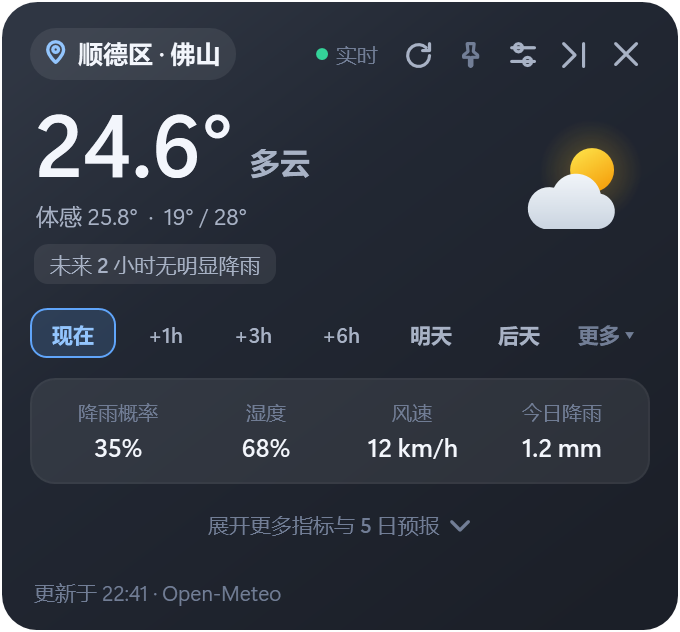
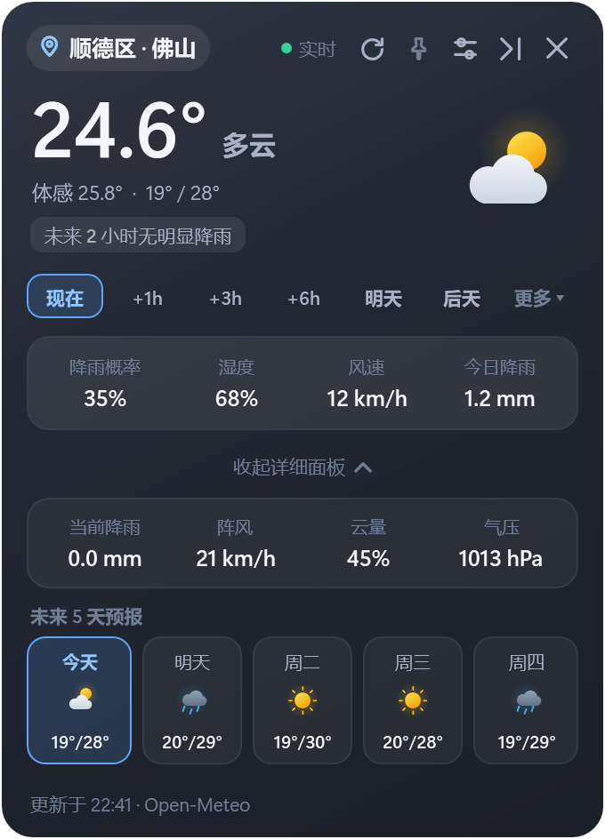
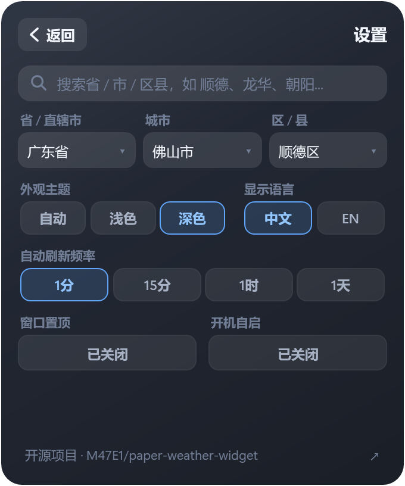
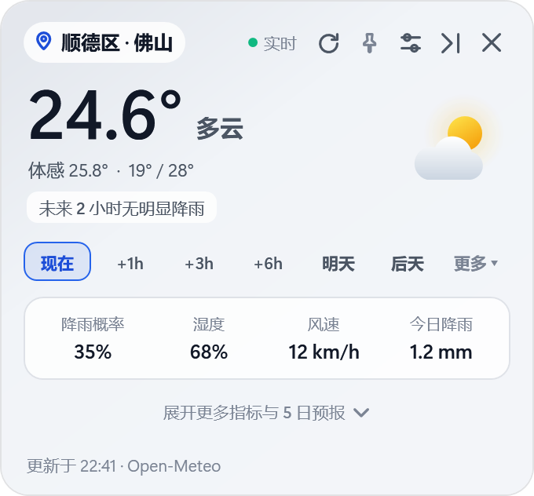
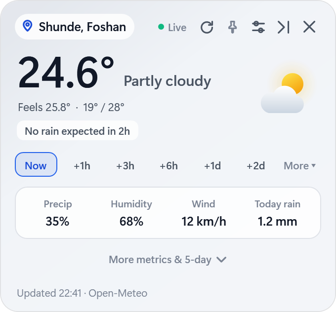

# Paper Weather Widget v4.0.0 / 纸感天气小组件

A lightweight, modern native Windows 10/11 desktop weather widget — completely refactored in v4.0.0 into a **single-process native C# WPF executable (~264 KB)** with adaptive Dark/Light themes, custom vector weather icons, instant China district search, and one-click forecast switching.

轻量级、现代化的原生 Windows 10/11 桌面天气小组件。v4.0.0 彻底重构为**纯原生单进程 C# WPF 单文件程序（仅 ~264 KB）**，移除旧版 PowerShell 后台进程与临时文件释放，内存占用大幅下降，并全面升级自适应深浅主题、自定义矢量图标、全国区县实时搜索与桌面交互体验。

## Preview / 界面预览

<table>
  <tr>
    <td align="center"><br /><sub>Dark Compact / 深色紧凑</sub></td>
    <td align="center"><br /><sub>Details & 5-Day / 详情与 5 日预报</sub></td>
    <td align="center"><br /><sub>Settings & Search / 设置与实时搜索</sub></td>
  </tr>
  <tr>
    <td align="center"><br /><sub>Light Mode / 浅色模式</sub></td>
    <td align="center"><br /><sub>English Mode / 英文模式</sub></td>
    <td align="center"><br /><sub>Edge Pill / 边缘天气胶囊</sub></td>
  </tr>
</table>

## What Changed in v4.0.0 / v4.0.0 核心重构亮点

| Metric / 指标 | Legacy v3.0.0 | Refactored v4.0.0 | Improvement |
| --- | --- | --- | --- |
| Processes / 后台进程 | 2 (WPF + `powershell.exe`) | **1** (Pure C# WPF) | Zero PowerShell worker |
| Idle Working Set / 待机物理内存 | 316.3 MB | **~3–6 MB** (peak ~87 MB) | **-98%+** |
| Private RAM / 专用内存 | 266.4 MB | **~69 MB** (`SoftwareOnly`) | **-74%** |
| Single EXE Size / 单文件体积 | 1,625.6 KB | **263.5 KB** | **-83.8%** |
| Embedded Region Catalog (2,875 districts) | 1,342.6 KB JSON | **72.7 KB** GZip TSV | **-94.6%**, lazy-loaded & auto-unloaded |

### Highlights / 核心功能
- **Single-File Portable EXE**: Download and run `PaperWeatherWidget-v4.0.0-win-x64.exe` directly — no installer, no admin privileges, no runtime extraction.
- **Adaptive Windows 11 Theme**: Automatically follows Windows Dark/Light mode (`Auto` / `Light` / `Dark`), paired with subtle weather-reactive atmospheric gradients and pure WPF vector icons.
- **Instant Region Search**: Search all **34 provinces, 370 cities, and 2,875 districts** in China by Chinese name, English, or Pinyin (plus cascading Province/City/District selectors).
- **On-Card Forecast Switcher**: Switch between `Now`, `+1h`, `+3h`, `+6h`, `Tomorrow`, `+2d`, and full 14-day / hourly slots directly on the main card with instant in-memory projection.
- **Expandable Details & 5-Day Strip**: Compact `340×316` default card with a one-click toggle to reveal secondary metrics (current rain, wind gust, cloud cover, pressure) and a clickable 5-day forecast row.
- **Live Edge-Docked Pill & System Tray**: Collapsing docks a compact `54×104` weather pill (showing live icon + temperature) to the left/right screen edge; supports vertical dragging, pin-on-top toggle, start-on-boot, single-instance guard, and system tray menu.
- **Bilingual & Offline-Ready**: Full Chinese / English UI (zero CJK leaks in English mode), automatic Open-Meteo primary + `wttr.in` fallback, proxy-to-direct automatic retry, and persistent offline cache.

## Download & Run / 下载与运行

Download `PaperWeatherWidget-v4.0.0-win-x64.exe` from the [GitHub Releases](https://github.com/M47E1/paper-weather-widget/releases) page and double-click to launch.

从 [GitHub Releases](https://github.com/M47E1/paper-weather-widget/releases) 下载 `PaperWeatherWidget-v4.0.0-win-x64.exe` 直接运行即可，无需安装或管理员权限。

## Build & Test from Source / 从源码构建与测试

No external SDK required — builds natively on Windows 10/11 using the built-in .NET Framework 4.8 C# compiler (`csc.exe`):

```powershell
powershell.exe -NoProfile -ExecutionPolicy Bypass -File .\build.ps1
powershell.exe -NoProfile -ExecutionPolicy Bypass -File .\test.ps1
```

Build output: `dist\PaperWeatherWidget-v4.0.0-win-x64.exe` and `dist\SHA256SUMS.txt`.

## Project Structure / 项目结构

```text
src/
├── Program.cs                  # Entry point, SoftwareOnly render mode, single-instance mutex
├── Models/
│   ├── AppSettings.cs          # Persistent settings & cached district coordinates
│   ├── RegionModels.cs         # Compact province/city/district models
│   └── WeatherModels.cs        # Weather snapshot, hourly/daily forecast, sync states
├── Services/
│   ├── LocalizationService.cs  # Bilingual zh/en dictionary, WMO codes, English region names
│   ├── RegionCatalogService.cs # Lazy GZip TSV loader + instant ZH/EN/Pinyin search
│   ├── SettingsService.cs      # Atomic JSON storage + Windows startup registry toggle
│   ├── TrayService.cs          # Lightweight native Windows NotifyIcon tray integration
│   └── WeatherService.cs       # Native async HTTP client (Open-Meteo + wttr.in + offline cache)
└── UI/
    ├── ThemePalette.cs         # Adaptive Dark/Light frozen brush palettes + weather gradients
    ├── GlassWindowHelper.cs    # Win11 DWM rounded corners, acrylic backdrop, working-set trim
    ├── WeatherIcons.cs         # Pure vector WPF weather icons & UI micro-icons
    ├── MainWindow.cs           # Compact adaptive card, forecast bar, expandable details
    ├── SettingsView.cs         # In-card settings & instant district search drawer
    └── CollapsedPillView.cs    # Edge-docked live icon + temperature pill
```

## Data, Privacy & License / 数据、隐私与许可证

- Weather data is fetched directly from [Open-Meteo](https://open-meteo.com/) (primary) and [wttr.in](https://wttr.in/) (fallback) using only the selected district's coordinates. No API key or account is needed.
- User settings and offline snapshots are stored locally in `%LOCALAPPDATA%\PaperWeatherWidget\` and are never committed to the repository.
- Licensed under the [MIT License](LICENSE).
